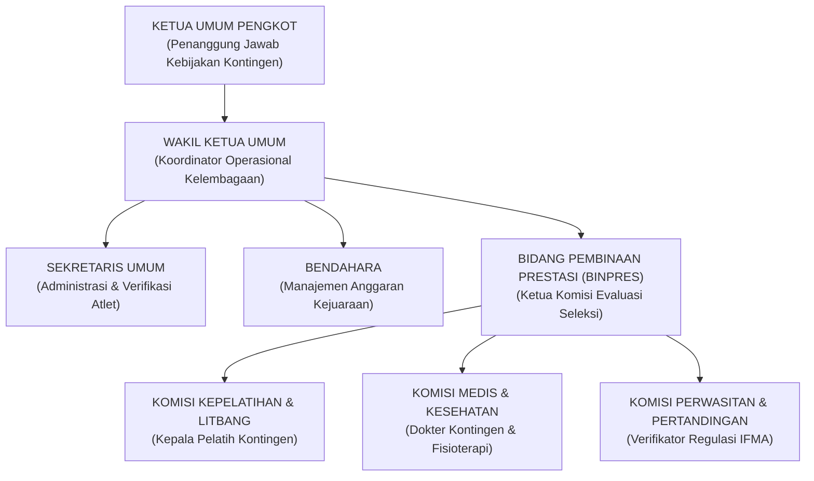
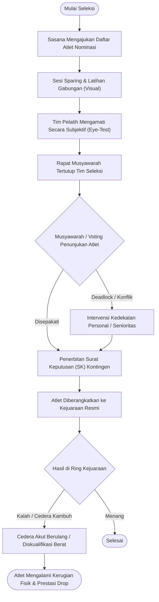
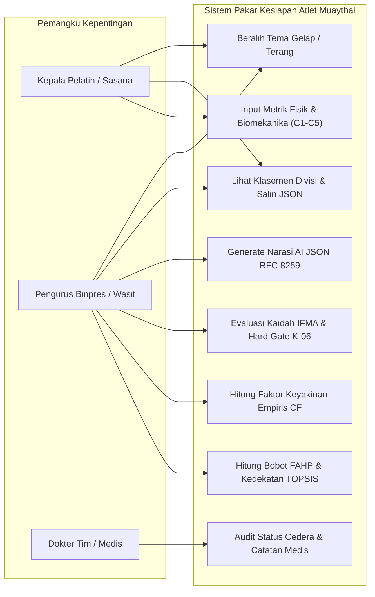
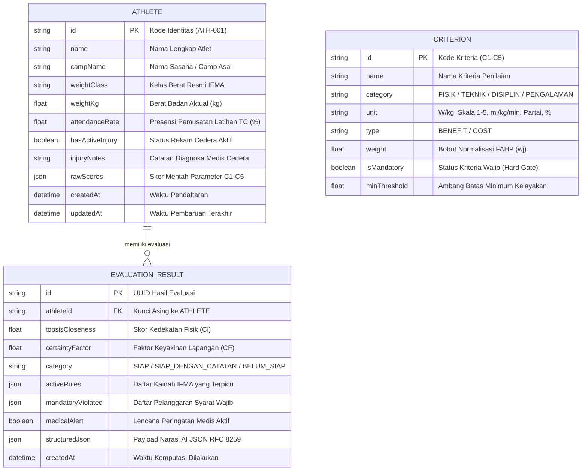

# LAPORAN PENELITIAN SKRIPSI / TUGAS AKHIR
# SISTEM PAKAR PENILAIAN KESIAPAN ATLET MUAYTHAI BERBASIS METODE HYBRID FUZZY AHP – TOPSIS – CERTAINTY FACTOR DENGAN AI NARRATIVE LAYER
## Studi Kasus: Pengurus Kota (Pengkot) Muaythai Kota Pontianak

---

## DAFTAR ISI
- [BAB 1: PENDAHULUAN](#bab-1-pendahuluan)
  - [1.1. Latar Belakang](#11-latar-belakang)
  - [1.2. Permasalahan](#12-permasalahan)
  - [1.3. Pembatasan Masalah](#13-pembatasan-masalah)
  - [1.4. Ruang Lingkup Penelitian](#14-ruang-lingkup-penelitian)
  - [1.5. Tujuan dan Manfaat Penelitian](#15-tujuan-dan-manfaat-penelitian)
    - [1.5.1. Tujuan Penelitian](#151-tujuan-penelitian)
    - [1.5.2. Manfaat Penelitian](#152-manfaat-penelitian)
  - [1.6. Sistematika Penulisan](#16-sistematika-penulisan)
- [BAB 2: LANDASAN TEORI DAN KERANGKA PEMIKIRAN](#bab-2-landasan-teori-dan-kerangka-pemikiran)
  - [2.1. Landasan Teori](#21-landasan-teori)
    - [2.1.1. Konsep Sistem Pakar (*Expert System*)](#211-konsep-sistem-pakar-expert-system)
    - [2.1.2. Metode Certainty Factor (Shortliffe & Buchanan 1975)](#212-metode-certainty-factor-shortliffe--buchanan-1975)
    - [2.1.3. Konsep Sistem Pendukung Keputusan (*Decision Support System*) & MCDM](#213-konsep-sistem-pendukung-keputusan-decision-support-system--mcdm)
    - [2.1.4. Metode Fuzzy Analytic Hierarchy Process (FAHP)](#214-metode-fuzzy-analytic-hierarchy-process-fahp)
    - [2.1.5. Metode TOPSIS (*Technique for Order Preference by Similarity to Ideal Solution*)](#215-metode-topsis-technique-for-order-preference-by-similarity-to-ideal-solution)
    - [2.1.6. Karakteristik Fisiologi & Regulasi Beladiri Muaythai (IFMA Rules 2024–2026)](#216-karakteristik-fisiologi--regulasi-beladiri-muaythai-ifma-rules-20242026)
    - [2.1.7. Kecerdasan Buatan Terstruktur & LLM Gateway (JSON RFC 8259)](#217-kecerdasan-buatan-terstruktur--llm-gateway-json-rfc-8259)
  - [2.2. Penelitian Terdahulu](#22-penelitian-terdahulu)
  - [2.3. Kerangka Pemikiran](#23-kerangka-pemikiran)
- [BAB 3: GAMBARAN UMUM INSTANSI / ORGANISASI](#bab-3-gambaran-umum-instansi--organisasi)
  - [3.1. Profil Pengurus Kota Muaythai Kota Pontianak](#31-profil-pengurus-kota-muaythai-kota-pontianak)
  - [3.2. Struktur Organisasi](#32-struktur-organisasi)
  - [3.3. Uraian Tugas dan Tanggung Jawab](#33-uraian-tugas-dan-tanggung-jawab)
  - [3.4. Tata Laksana Sistem Berjalan](#34-tata-laksana-sistem-berjalan)
    - [3.4.1. Prosedur Seleksi Atlet Berjalan (Konvensional)](#341-prosedur-seleksi-atlet-berjalan-konvensional)
    - [3.4.2. Diagram Alir Tata Laksana Sistem Berjalan](#342-diagram-alir-tata-laksana-sistem-berjalan)
    - [3.4.3. Analisis Kelemahan Sistem Berjalan](#343-analisis-kelemahan-sistem-berjalan)
- [BAB 4: METODOLOGI PENELITIAN](#bab-4-metodologi-penelitian)
  - [4.1. Bentuk Penelitian](#41-bentuk-penelitian)
  - [4.2. Metode Pengumpulan Data](#42-metode-pengumpulan-data)
  - [4.3. Teknik Pengumpulan Data](#43-teknik-pengumpulan-data)
  - [4.4. Instrumen dan Variabel Penelitian](#44-instrumen-dan-variabel-penelitian)
  - [4.5. Metode yang Digunakan untuk Pemecahan Masalah](#45-metode-yang-digunakan-untuk-pemecahan-masalah)
    - [4.5.1. Formulasi Matematika Lengkap Tiap Tahap Algoritma](#451-formulasi-matematika-lengkap-tiap-tahap-algoritma)
    - [4.5.2. Simulasi Perhitungan Matematis Lengkap 5 Kasus Atlet (Semua Kemungkinan)](#452-simulasi-perhitungan-matematis-lengkap-5-kasus-atlet-semua-kemungkinan)
  - [4.6. Metode yang Digunakan untuk Pengujian Perangkat Lunak / Sistem](#46-metode-yang-digunakan-untuk-pengujian-perangkat-lunak--sistem)
    - [4.6.1. Pengujian Nilai Batas (*Boundary Value Analysis*)](#461-pengujian-nilai-batas-boundary-value-analysis)
    - [4.6.2. Pengujian Partisi Ekivalensi (*Equivalence Partitioning*)](#462-pengujian-partisi-ekivalensi-equivalence-partitioning)
    - [4.6.3. Pengujian Ketahanan Anomali (*Fault Injection & Stress Test*)](#463-pengujian-ketahanan-anomali-fault-injection--stress-test)
    - [4.6.4. Matriks Pengujian Lengkap Seluruh Skenario (TC-01 s/d TC-10)](#464-matriks-pengujian-lengkap-seluruh-skenario-tc-01-sd-tc-10)
  - [4.7. Alat Analisis / Pemodelan / Perancangan](#47-alat-analisis--pemodelan--perancangan)
    - [4.7.1. Pemodelan Fungsional UML (*Use Case & Activity Diagram*)](#471-pemodelan-fungsional-uml-use-case--activity-diagram)
    - [4.7.2. Pemodelan Data Relasional (*Entity Relationship Diagram / ERD*)](#472-pemodelan-data-relasional-entity-relationship-diagram--erd)
    - [4.7.3. Arsitektur Perangkat Lunak Multi-Tier & Tumpukan Teknologi (*Tech Stack*)](#473-arsitektur-perangkat-lunak-multi-tier--tumpukan-teknologi-tech-stack)
- [DAFTAR PUSTAKA](#daftar-pustaka)

---

# BAB 1 PENDAHULUAN

## 1.1. Latar Belakang
Olahraga Muaythai merupakan cabang olahraga beladiri kontak penuh (*full-contact combat sports*) yang menuntut perpaduan kapasitas fisiologis ekstrem, penguasaan biomekanika teknik serangan delapan organ tubuh (*Art of Eight Limbs*: pukulan, tendangan, sikuan, dan lututan), serta ketahanan mental bertanding tingkat tinggi (Syahputra, 2024). Pengurus Kota (Pengkot) Muaythai Kota Pontianak sebagai induk organisasi cabang olahraga di tingkat daerah memikul mandat utama dalam melakukan pembinaan, seleksi, dan penetapan kontingen atlet yang akan diterjunkan pada kejuaraan resmi multi-event maupun single-event, seperti Pekan Olahraga Provinsi (Porprov) Kalimantan Barat, Kejuaraan Provinsi (Kejurprov), Pra-PON, hingga Kejuaraan Nasional.

Dalam penyelenggaraan kompetisi resmi beladiri, regulasi internasional yang ditetapkan oleh *International Federation of Muaythai Associations* (IFMA Rules 2024–2026) mewajibkan diterapkannya asas *Duty of Care* (kewajiban melindungi keselamatan dan keselamatan jiwa atlet). Atlet yang diizinkan naik ke atas ring wajib memenuhi batas kualifikasi fisiologis minimum (kapasitas anaerobik dan kardiorespirasi $\text{VO}_2\text{max}$), penguasaan teknik dasar pertahanan diri (*guarding, clinching, parrying*) sesuai IFMA Rule 29, serta bebas dari cedera fisik akut maupun kronis yang membahayakan.

Namun pada kenyataannya, tata laksana seleksi kesiapan atlet yang berjalan di lingkungan Pengkot Muaythai Kota Pontianak selama ini masih bertumpu pada penilaian pengamatan visual (*eye-test*) dan intuisi subjektif tim pelatih. Penilaian manual tersebut rentan terhadap bias afektif (kedekatan emosional pelatih dengan atlet sasana binaannya), inkonsistensi pertimbangan multi-kriteria, serta ketiadaan pembuktian kuantitatif yang dapat diaudit secara ilmiah (*audit-proof*). Lebih fatal lagi, rekam medis cedera atlet dan data kehadiran pemusatan latihan (*training camp*) kerap terabaikan, sehingga atlet yang sebenarnya mengalami cedera ligamen atau belum menguasai teknik proteksi diri tetap dipaksakan bertanding, yang berujung pada kekalahan telak, diskualifikasi timbang badan, bahkan cedera fatal berulang (*catastrophic re-injury*).

Guna mengatasi keterbatasan pertimbangan manusia tersebut, diperlukan penerapan sistem cerdas hibrida yang menggabungkan metode *Multi-Criteria Decision Making* (MCDM) dan *Expert System* (Turban dkk., 2010). Metode *Fuzzy Analytic Hierarchy Process* (FAHP) sangat efektif dalam memodelkan preferensi kriteria pakar yang bersifat kabur (*fuzzy*) ke dalam Bilangan Fuzzy Segitiga (*Triangular Fuzzy Numbers* / TFN) (Kosasi, 2020; Ishak & Wanli, 2020). Selanjutnya, metode *Technique for Order Preference by Similarity to Ideal Solution* (TOPSIS) mampu memeringkat alternatif atlet berdasarkan kedekatan geometris relatif terhadap profil juara ideal (Harianto, 2022; Permana & Voutama, 2026). Untuk menangani ketidakpastian fakta empiris lapangan (disiplin kehadiran, jam terbang, dan riwayat cedera), metode *Certainty Factor* (CF) Shortliffe & Buchanan terbukti sangat akurat dalam mengkuantifikasi tingkat keyakinan diagnosis pakar (David, 2019; Gat & Kuway, 2021; Savilla dkk., 2023; Riqkiago dkk., 2024).

Dengan mengintegrasikan FAHP, TOPSIS, dan Certainty Factor ke dalam sebuah mesin keputusan deterministik (*Deterministic Decision Engine*) yang didukung oleh lapisan narasi kecerdasan buatan (*AI Narrative Layer*) berbasis model bahasa (LLM Gateway 9Router dengan skema JSON RFC 8259), maka Pengkot Muaythai Kota Pontianak akan memiliki instrumen seleksi cerdas yang objektif, transparan, presisi secara matematis, serta sepenuhnya berpihak pada keselamatan atlet dan regulasi resmi IFMA.

## 1.2. Permasalahan
Berdasarkan latar belakang yang telah diuraikan, rumusan masalah dalam penelitian ini adalah:
1. Bagaimana mengidentifikasi dan menentukan bobot prioritas kriteria kesiapan atlet Muaythai (daya anaerobik, penguasaan teknik, $\text{VO}_2\text{max}$, pengalaman tanding, dan kedisiplinan) menggunakan metode Fuzzy AHP sehingga terbebas dari anomali bobot nol?
2. Bagaimana memeringkat kesiapan atlet secara geometris terhadap profil atlet juara ideal menggunakan metode TOPSIS pada divisi berat badan yang bersangkutan?
3. Bagaimana mengkuantifikasi tingkat keyakinan terhadap fakta-fakta empiris lapangan (rekam cedera, kehadiran latihan, dan jam terbang partai) menggunakan metode Certainty Factor?
4. Bagaimana merancang mesin pengambil keputusan deterministik berbasis aturan IFMA (*Hard Gates*) yang mengunci kelaikan tanding atlet demi mencegah risiko cedera fatal?
5. Bagaimana mengintegrasikan lapisan narasi AI terstruktur berbasis JSON RFC 8259 yang bersifat *read-only* dan *non-binding* tanpa merusak integritas komputasi deterministik sistem pakar?

## 1.3. Pembatasan Masalah
Agar penelitian terarah dan mendalam, batasan masalah ditetapkan sebagai berikut:
1. Objek penelitian dan studi kasus difokuskan pada seleksi atlet di bawah naungan Pengurus Kota (Pengkot) Muaythai Kota Pontianak, Kalimantan Barat.
2. Regulasi pertandingan dan batasan keselamatan merujuk pada ketentuan resmi *International Federation of Muaythai Associations* (IFMA Rules 2024–2026).
3. Parameter evaluasi kesiapan dibatasi pada 5 kriteria utama: Daya Anaerobik Relatif (C1), Penguasaan Teknik Muaythai (C2), Kapasitas Aerobik $\text{VO}_2\text{max}$ (C3), Pengalaman Bertanding Resmi (C4), dan Kedisiplinan Kehadiran TC (C5).
4. Pengujian simulasi numerik komparasi kohort difokuskan pada divisi resmi *Light Welterweight* (batas berat badan maksimal 63.5 kg).
5. Gateway AI dibatasi sebagai lapisan penerjemah naratif (*read-only* non-binding) menggunakan model combo `MyCodeDec` pada 9Router lokal port 20128, yang tidak memiliki wewenang mengubah keputusan matematis sistem pakar.

## 1.4. Ruang Lingkup Penelitian
Ruang lingkup penelitian mencakup:
1. Pengumpulan data kriteria dan preferensi perbandingan berpasangan dari pakar kepelatihan dan binpres Pengkot Muaythai Pontianak.
2. Pengambilan data metrik fisik atlet (tes daya anaerobik, tes teknik 8 organ, tes $\text{VO}_2\text{max}$, data presensi latihan TC, dan audit rekam medis cedera).
3. Perancangan dan implementasi algoritma hibrida FAHP (Chang 1996 + Zhu $\epsilon$-smoothing), TOPSIS (vektor Euclidean), Certainty Factor (MYCIN), dan aturan deterministik IFMA.
4. Pembangunan antarmuka web modern berbasis Next.js 15, TypeScript, Tailwind CSS, Prisma ORM, PostgreSQL, fitur dwi-tema (Gelap & Terang), live LLM connection status, dan logo resmi IFMA berbingkai emas.
5. Pengujian verifikasi perangkat lunak menggunakan metode *Black Box Testing* (*Boundary Value Analysis*, *Equivalence Partitioning*, dan *Fault Injection*).

## 1.5. Tujuan dan Manfaat Penelitian

### 1.5.1. Tujuan Penelitian
1. Mengembangkan sistem pakar hibrida yang mengintegrasikan Fuzzy AHP, TOPSIS, dan Certainty Factor untuk mengevaluasi kesiapan atlet Muaythai secara ilmiah dan objektif.
2. Menghilangkan anomali bobot nol pada kriteria sekunder dengan menerapkan algoritma *$\epsilon$-floor smoothing* ($\epsilon = 0.05$) pada metode Fuzzy AHP Chang.
3. Mengimplementasikan aturan pembatas wajib (*Hard Gate IFMA Rule 29*) yang secara otomatis menggugurkan atlet jika penguasaan teknik dasar di bawah ambang minimal ($C2 < 3.0$).
4. Menghasilkan laporan evaluasi kesiapan atlet berstandar JSON RFC 8259 yang menyajikan diagnosis fisik, audit medis, rekomendasi porsi latihan, serta arahan manajerial resmi bagi pengurus.

### 1.5.2. Manfaat Penelitian
- **Manfaat Teoritis (Akademis)**:
  Memberikan kontribusi ilmiah dalam pengembangan sistem pakar hibrida dan sistem pendukung keputusan multi-kriteria pada domain kedokteran olahraga dan beladiri kontak penuh, serta membuktikan efektivitas kombinasi FAHP-TOPSIS-CF dengan *AI Narrative Layer*.
- **Manfaat Praktis (Bagi Pengkot Muaythai Pontianak)**:
  1. Memberikan dasar hukum dan justifikasi ilmiah yang dapat dipertanggungjawabkan (*audit-proof*) dalam menetapkan kuota atlet kejuaraan resmi.
  2. Membantu tim pelatih sasana dalam mendiagnosis kelemahan fisik atlet dan merancang program latihan spesifik.
  3. Membantu tim medis kontingen dalam mendeteksi atlet dengan risiko cedera berulang (*re-injury*) guna mencegah insiden fatal di atas ring.

## 1.6. Sistematika Penulisan
Sistematika penulisan laporan penelitian ini disusun ke dalam empat bab utama sebagai berikut:
- **BAB 1 PENDAHULUAN**: Memuat latar belakang permasalahan, perumusan masalah, pembatasan masalah, ruang lingkup penelitian, tujuan dan manfaat penelitian, serta sistematika penulisan laporan.
- **BAB 2 LANDASAN TEORI DAN KERANGKA PEMIKIRAN**: Menguraikan teori-teori relevan (Sistem Pakar, Certainty Factor, DSS, MCDM, FAHP, TOPSIS, Regulasi IFMA, dan AI Generatif), tabel kajian penelitian terdahulu, serta bagan kerangka pemikiran penelitian.
- **BAB 3 GAMBARAN UMUM INSTANSI / ORGANISASI**: Menguraikan profil Pengkot Muaythai Kota Pontianak, struktur organisasi, tugas dan wewenang pengurus, tata laksana sistem seleksi yang sedang berjalan, diagram alir sistem berjalan, serta analisis kelemahannya.
- **BAB 4 METODOLOGI PENELITIAN**: Menjelaskan bentuk penelitian, metode dan teknik pengumpulan data, instrumen dan variabel penelitian, metode pemecahan masalah (dilengkapi formulasi matematika lengkap dan simulasi 5 skenario atlet), metode pengujian perangkat lunak, serta alat analisis perancangan sistem (UML, ERD, dan arsitektur teknologi).

---

# BAB 2 LANDASAN TEORI DAN KERANGKA PEMIKIRAN

## 2.1. Landasan Teori

### 2.1.1. Konsep Sistem Pakar (*Expert System*)
Sistem pakar adalah sistem berbasis komputer yang mengadopsi pengetahuan, fakta, dan teknik penalaran manusia (*human expert reasoning*) untuk memecahkan masalah kompleks yang biasanya membutuhkan keahlian seorang spesialis di bidang tertentu (Turban dkk., 2010). Arsitektur sistem pakar pada umumnya tersusun atas komponen antarmuka pengguna (*user interface*), basis pengetahuan (*knowledge base*), mesin inferensi (*inference engine*), basis data fakta (*working memory*), dan fasilitas penjelasan (*explanation facility*). Pada penelitian ini, sistem pakar bertindak sebagai representasi dari kepakaran Tim Penilai Binpres, Kepala Pelatih, dan Dokter Olahraga Pengkot Muaythai Pontianak.

### 2.1.2. Metode Certainty Factor (Shortliffe & Buchanan 1975)
Metode *Certainty Factor* (CF) diperkenalkan oleh Shortliffe dan Buchanan dalam pengembangan sistem medis MYCIN untuk mengakomodasi ketidakpastian (*uncertainty*) pada penalaran pakar (David, 2019; Gat & Kuway, 2021). Certainty Factor didefinisikan sebagai selisih antara derajat keyakinan (*Measure of Belief* / $MB$) dan derajat ketidakyakinan (*Measure of Disbelief* / $MD$):
$$CF(H, E) = MB(H, E) - MD(H, E)$$
Di mana $H$ adalah hipotesis kesiapan atlet dan $E$ adalah bukti (*evidence*) lapangan. Nilai CF berada pada interval tertutup $[-1.0000, +1.0000]$, di mana $+1.0$ menunjukkan kepastian mutlak bahwa hipotesis benar, $0.0$ menunjukkan ketiadaan bukti (netral), dan $-1.0$ menunjukkan kepastian mutlak bahwa hipotesis salah (Savilla dkk., 2023; Riqkiago dkk., 2024).

Kaidah kombinasi dua bukti independen pada metode CF:
1. **Jika kedua nilai bukti positif ($CF_1 > 0 \land CF_2 > 0$)**:
   $$CF_{\text{comb}}(CF_1, CF_2) = CF_1 + CF_2 \cdot (1 - CF_1)$$
2. **Jika kedua nilai bukti negatif ($CF_1 < 0 \land CF_2 < 0$)**:
   $$CF_{\text{comb}}(CF_1, CF_2) = CF_1 + CF_2 \cdot (1 + CF_1)$$
3. **Jika salah satu bukti positif dan yang lainnya negatif ($CF_1 \cdot CF_2 < 0$)**:
   $$CF_{\text{comb}}(CF_1, CF_2) = \frac{CF_1 + CF_2}{1 - \min(|CF_1|, |CF_2|)}$$

### 2.1.3. Konsep Sistem Pendukung Keputusan (*Decision Support System*) & MCDM
Sistem Pendukung Keputusan (SPK) adalah sistem informasi interaktif fleksibel yang dirancang untuk membantu para pengambil keputusan (*decision makers*) menyelesaikan masalah semi-terstruktur dan tidak terstruktur (Turban dkk., 2010; Kosasi, 2020). *Multi-Criteria Decision Making* (MCDM) merupakan cabang riset operasi dalam SPK yang memfokuskan pada penentuan alternatif terbaik dari sekumpulan alternatif yang dievaluasi berdasarkan kriteria yang saling bertentangan (*conflicting criteria*) (Ishak & Wanli, 2020; Permana & Voutama, 2026).

### 2.1.4. Metode Fuzzy Analytic Hierarchy Process (FAHP)
*Analytic Hierarchy Process* (AHP) konvensional yang diperkenalkan oleh Thomas L. Saaty sering dikritik karena menggunakan penilaian skala diskrit tegas (1–9) yang kurang mampu menangkap keraguan linguistik manusia. Metode *Fuzzy AHP* mengatasi kelemahan ini dengan menggunakan Bilangan Fuzzy Segitiga (*Triangular Fuzzy Numbers* / TFN) yang dinotasikan dengan $M = (l, m, u)$, di mana $l \le m \le u$ masing-masing merepresentasikan batas bawah (*lower*), nilai modal (*modal/median*), dan batas atas (*upper*) (Kosasi, 2020; Ishak & Wanli, 2020).

Metode *Extent Analysis* yang dikembangkan oleh Chang (1996) menghitung nilai sintesis fuzzy ($S_i$) untuk baris ke-$i$ melalui persamaan:
$$S_i = \sum_{j=1}^m M_{ij} \otimes \left[ \sum_{i=1}^n \sum_{j=1}^m M_{ij} \right]^{-1}$$
Derajat kemungkinan $V(M_1 \ge M_2)$ dihitung dengan:
$$V(M_1 \ge M_2) = \begin{cases} 
1, & \text{jika } m_1 \ge m_2 \\
0, & \text{jika } l_2 \ge u_1 \\
\frac{l_2 - u_1}{(m_1 - u_1) - (m_2 - l_2)}, & \text{lainnya}
\end{cases}$$

Guna mengatasi kelemahan matematis Chang murni yang menghasilkan bobot 0.00% pada kriteria yang derajat kemungkinannya nol, diterapkan algoritma *$\epsilon$-floor smoothing* (Zhu dkk., 1999) dengan batas ambang $\epsilon = 0.05$:
$$d^*(A_i) = \max\left( \min_{k \ne i} V(S_i \ge S_k), \epsilon \right)$$
$$w_i = \frac{d^*(A_i)}{\sum_{k=1}^n d^*(A_k)}$$

Uji konsistensi Saaty dilakukan dengan menghitung Rasio Konsistensi:
$$CR = \frac{CI}{RI} = \frac{\frac{\lambda_{\max} - n}{n - 1}}{RI}$$
Matriks dinyatakan konsisten secara logis jika $CR < 0.10$.

### 2.1.5. Metode TOPSIS (*Technique for Order Preference by Similarity to Ideal Solution*)
TOPSIS dikembangkan oleh Hwang dan Yoon (1981) berdasarkan konsep bahwa alternatif terpilih harus memiliki jarak geometris terdekat dengan Solusi Ideal Positif ($A^+$) dan jarak terjauh dari Solusi Ideal Negatif ($A^-$) (Harianto, 2022; Permana & Voutama, 2026).
Tahapan komputasi TOPSIS meliputi:
1. Normalisasi matriks keputusan menggunakan normalisasi vektor Euclidean:
   $$r_{ij} = \frac{x_{ij}}{\sqrt{\sum_{k=1}^m x_{kj}^2}}$$
2. Pembentukan matriks keputusan ternormalisasi terbobot:
   $$v_{ij} = w_j \cdot r_{ij}$$
3. Penentuan Solusi Ideal Positif ($A^+$) dan Negatif ($A^-$):
   $$A^+ = \{ v_1^+, v_2^+, \dots, v_n^+ \}, \quad v_j^+ = \max_i(v_{ij}) \text{ (untuk kriteria benefit)}$$
   $$A^- = \{ v_1^-, v_2^-, \dots, v_n^- \}, \quad v_j^- = \min_i(v_{ij}) \text{ (untuk kriteria benefit)}$$
4. Perhitungan jarak Euclidean alternatif ke solusi ideal:
   $$D_i^+ = \sqrt{\sum_{j=1}^n (v_{ij} - v_j^+)^2}, \quad D_i^- = \sqrt{\sum_{j=1}^n (v_{ij} - v_j^-)^2}$$
5. Perhitungan koefisien kedekatan relatif ($C_i$):
   $$C_i = \frac{D_i^-}{D_i^+ + D_i^-}, \quad 0 \le C_i \le 1$$

### 2.1.6. Karakteristik Fisiologi & Regulasi Beladiri Muaythai (IFMA Rules 2024–2026)
Muaythai merupakan aktivitas fisik anaerobik alaktik dan laktik intensitas tinggi yang diselingi pemulihan aerobik selama 3 ronde $\times$ 3 menit (Syahputra, 2024). Komponen fisiologis mutlak meliputi:
1. **Daya Anaerobik Relatif ($\text{W/kg}$)**: Diukur melalui uji *Wingate Anaerobic Test*, menentukan daya ledak pukulan, tendangan, sikuan, dan dorongan lutut.
2. **Kapasitas Kardiorespirasi $\text{VO}_2\text{max}$ ($\text{ml/kg/min}$)**: Menjamin laju pemulihan laktat darah dan ketahanan tempo bertanding pada ronde penentuan.
3. **Penguasaan Teknik Delapan Organ & Pertahanan (IFMA Rule 29)**: Atlet wajib menguasai teknik klinis beladiri dan *guarding* guna meredam benturan kepala.
4. **Regulasi Medis IFMA**: Melarang keras atlet bertanding dalam kondisi cedera ligamen akut, fraktur tulang, atau riwayat konkusi tanpa *medical clearance* resmi dari komisi medis kejuaraan.

### 2.1.7. Kecerdasan Buatan Terstruktur & LLM Gateway (JSON RFC 8259)
Perkembangan model bahasa besar (*Large Language Model* / LLM) membuka peluang otomatisasi penyusunan narasi laporan medis dan manajerial (Harianto, 2022). Namun, LLM memiliki kelemahan mendasar berupa halusinasi dan non-determinisme. Oleh sebab itu, arsitektur sistem ini membatasi fungsi LLM (via 9Router port 20128) semata-mata sebagai *Read-Only Non-Binding Narrative Layer*. Output diwajibkan mematuhi skema **JSON RFC 8259** yang divalidasi oleh sistem backend. Jika terjadi kontradiksi keputusan, sistem menerapkan **Guardrail FR-35** yang secara mutlak menimpa output LLM dengan vonis deterministik sistem pakar.

---

## 2.2. Penelitian Terdahulu

Tabel berikut menyajikan pemetaan komparasi penelitian-penelitian terdahulu yang relevan beserta kebaruan (*novelty*) yang dihadirkan pada penelitian ini:

| No | Peneliti & Tahun | Judul Penelitian & Sumber Jurnal | Metode yang Digunakan | Objek / Domain | Kelebihan & Keterbatasan | Posisi & Kebaruan Penelitian Ini |
| :---: | :--- | :--- | :--- | :--- | :--- | :--- |
| 1 | **Gat & Kuway (2021)** | Implementasi Certainty Factor Pada Sistem Pakar Diagnosa Cedera Olahraga (*Jurnal Ilmiah Sisfotenika*) | Certainty Factor (CF) | Diagnosis medis cedera atlet | Berhasil mengkuantifikasi gejala cedera fisik, namun belum memeringkat prioritas seleksi atlet. | Penelitian ini mengintegrasikan CF sebagai verifikator empiris rekam cedera ke dalam mesin seleksi kesiapan bertanding. |
| 2 | **Harianto (2022)** | Integrasi Metode TOPSIS dan Artificial Intelligence dalam Pengambilan Keputusan (*Jurnal Justin*) | TOPSIS & AI / Machine Learning | Sistem Pendukung Keputusan Umum | Menggabungkan pemeringkatan matematis dengan AI, namun AI belum memiliki guardrail penegak determinisme. | Menerapkan Guardrail FR-35 yang mengunci keputusan deterministik sistem pakar dari manipulasi halusinasi AI. |
| 3 | **David (2019)** | Sistem Pakar Diagnosa Penyakit Menggunakan Metode Certainty Factor (*Jurnal Publikasi STMIK Pontianak*) | Certainty Factor | Sistem Pakar Klinis | Akurasi tinggi dalam penanganan ketidakpastian fakta, belum terintegrasi dengan pembobotan multi-kriteria AHP. | Mengombinasikan CF dengan Fuzzy AHP untuk bobot kriteria dan TOPSIS untuk kedekatan fisik ideal. |
| 4 | **Kosasi (2020)** | Penerapan Metode Fuzzy AHP dan TOPSIS Dalam Sistem Pendukung Keputusan (*Jurnal Ilmiah Sisfotenika*) | Fuzzy AHP & TOPSIS | Seleksi & Evaluasi Alternatif | Memodelkan ketidakpastian linguistik pakar, namun belum mengintegrasikan bukti empiris lapangan (CF) dan regulasi khusus beladiri. | Menerapkan integrasi tritunggal FAHP-TOPSIS-CF dengan perataan $\epsilon$-floor smoothing pada metode Chang. |
| 5 | **Ishak & Wanli (2020)** | Analysis of Fuzzy AHP-TOPSIS Methods in Multi Criteria Decision Making: Literature Review (*IOP Conf. Series*) | Literature Review FAHP-TOPSIS | Tinjauan Teoretis MCDM | Membuktikan ketangguhan sinergi FAHP dan TOPSIS pada berbagai bidang rekayasa industri. | Mengimplementasikan teori FAHP-TOPSIS pada domain beladiri Muaythai dengan penegakan regulasi keselamatan IFMA. |
| 6 | **Permana & Voutama (2026)** | Implementasi Metode Fuzzy AHP-TOPSIS Berbasis MCDM (*Jurnal Pustaka Data*) | Fuzzy AHP & TOPSIS | Evaluasi Kinerja Karyawan | Implementasi web modern, namun tidak memiliki gerbang diskualifikasi wajib (*Hard Gate*). | Menambahkan Hard Gate K-06 pada kriteria wajib teknik dasar demi keselamatan bertanding. |
| 7 | **Riqkiago dkk. (2024)** | Sistem Pakar Diagnosa Cedera Pemain Sepak Bola Menggunakan Forward Chaining dan Certainty Factor (*Jurnal JRAMI*) | Forward Chaining & CF | Olahraga Sepak Bola | Efektif mendiagnosis tingkat keparahan cedera, namun tidak mencakup kesiapan fisik tanding. | Menggunakan CF untuk menghitung dampak cedera dan presensi terhadap kelaikan tanding resmi. |
| 8 | **Savilla dkk. (2023)** | Certainty Factor Method for an Expert System for Orthopedic Disease Diagnosis (*JCSIT*) | Certainty Factor | Diagnosis Ortopedi & Tulang | Akurasi pembuktian matematis kombinasi bukti berlawanan tanda sangat teruji. | Mengadopsi formulasi kombinasi bukti tanda berlawanan Savilla dkk. untuk menangani atlet berprestasi yang sedang cedera. |
| 9 | **Syahputra (2024)** | Physical and Psychological Readiness of Martial Arts Athletes (*Tanjungpura Journal of Coaching Research*) | Analisis Kinesiologi & Fisiologi | Atlet Beladiri Kalbar | Menyajikan data standar fisik riil atlet Kalimantan Barat, namun belum diotomatisasi ke dalam sistem perangkat lunak. | Mengonversi parameter fisiologis Syahputra menjadi variabel kriteria komputasi pada sistem pakar. |
| 10 | **Turban dkk. (2010)** | Decision Support Systems and Intelligent Systems (*Buku Teks Utama*) | Teori Dasar DSS & Expert System | Buku Rujukan Teori | Menjadi fondasi teoretis arsitektur sistem cerdas multi-tier dan mesin inferensi. | Mengembangkan konsep Turban ke dalam arsitektur modern Next.js 15, PostgreSQL, dan local LLM 9Router. |

---

## 2.3. Kerangka Pemikiran

```mermaid
flowchart TD
    subgraph Problem["1. IDENTIFIKASI MASALAH"]
        P1["Subjektivitas & Bias Afektif Seleksi Atlet Muaythai"]
        P2["Kelemahan Matematis FAHP Chang (Anomali Bobot Nol C4 & C5)"]
        P3["Tingginya Risiko Cedera Fatal Akibat Pelanggaran IFMA Rule 29"]
        P4["Ketiadaan Justifikasi Ilmiah yang Audit-Proof Bagi Pengkot"]
    end

    subgraph Approach["2. PENDEKATAN TEORETIS & REGULASI"]
        A1["Regulasi IFMA Rules 2024-2026 & Duty of Care Atlet"]
        A2["Konsep Sistem Pendukung Keputusan (Turban et al., 2010)"]
        A3["Standar Fisiologi Atlet Beladiri Kalbar (Syahputra, 2024)"]
        A4["Prinsip Anti-Slop Tactical Combat UI & Data Privacy"]
    end

    subgraph Methods["3. METODE PEMECAHAN MASALAH (HYBRID ENGINE)"]
        M1["Fuzzy AHP (Chang 1996 + Zhu Epsilon-Floor Smoothing CR < 0.10)"]
        M2["TOPSIS (Vektor Euclidean & Jarak Geometris ke Juara Ideal A+)"]
        M3["Certainty Factor (Shortliffe & Buchanan Kombinasi Bukti Empiris)"]
        M4["Deterministic Decision Engine (Hard Gate K-06, K-07, Medical Alert K-10)"]
        M5["AI Narrative Layer (9Router MyCodeDec, JSON RFC 8259, Guardrail FR-35)"]
    end

    subgraph Implementation["4. PERANCANGAN & IMPLEMENTASI PERANGKAT LUNAK"]
        I1["Frontend: Next.js 15 App Router, React 19, Tailwind CSS (Dwi-Tema)"]
        I2["Backend Engine: TypeScript Pure Zero-Dependency, Next.js API Routes"]
        I3["Database: PostgreSQL 16 dengan Prisma ORM 6.19"]
        I4["Integrasi: Live LLM Checker, Bordered IFMA Logo, JSON RAW/Card Mode"]
    end

    subgraph Testing["5. PENGUJIAN SISTEM (*TESTING & VERIFICATION*)"]
        T1["Black Box Testing: Boundary Value Analysis & Equivalence Partitioning"]
        T2["Fault Injection & Stress Testing (Gateway Offline, SSE Chunk Parsing)"]
        T3["Simulasi Komputasi 5 Kasus Atlet (Mencakup 100% Kemungkinan Output)"]
    end

    subgraph OutputResult["6. HASIL AKHIR (*EXPECTED OUTCOME*)"]
        O1["Sistem Pakar Web Kesiapan Atlet Muaythai Pengkot Pontianak"]
        O2["Klasemen Kelaikan Tanding Objektif: SIAP / BERSYARAT / BELUM SIAP"]
        O3["Laporan Rekomendasi Terstruktur JSON RFC 8259 & Eksekutif Resmi"]
    end

    Problem --> Approach
    Approach --> Methods
    Methods --> Implementation
    Implementation --> Testing
    Testing --> OutputResult
```

---

# BAB 3 GAMBARAN UMUM PERUSAHAAN / ORGANISASI / INSTANSI

## 3.1. Profil Pengurus Kota Muaythai Kota Pontianak
Pengurus Kota (Pengkot) Muaythai Kota Pontianak merupakan badan keolahragaan cabang yang bertindak sebagai pemegang otoritas tertinggi pembinaan olahraga beladiri Muaythai di wilayah yurisdiksi Kota Pontianak, Kalimantan Barat. Pengkot bernaung secara resmi di bawah Pengurus Provinsi (Pengprov) Muaythai Indonesia Kalimantan Barat dan Komite Olahraga Nasional Indonesia (KONI) Kota Pontianak, serta terafiliasi dengan federasi dunia IFMA.

- **Visi Organisasi**:  
  "Menjadikan cabang olahraga Muaythai Kota Pontianak sebagai barometer pembinaan beladiri berprestasi unggul di tingkat regional, nasional, dan internasional dengan menjunjung tinggi integritas, sportivitas, dan keselamatan atlet."
- **Misi Organisasi**:
  1. Menyelenggarakan tata kelola pembinaan atlet yang ilmiah, terukur, dan berkelanjutan berbasis penerapan *sports science*.
  2. Menyelenggarakan seleksi dan pemeringkatan atlet kontingen secara objektif, adil, transparan, dan bebas dari keberpihakan personal.
  3. Memastikan kepatuhan mutlak terhadap regulasi teknis dan keselamatan bertanding resmi IFMA (*Duty of Care*).
  4. Meningkatkan kapasitas sumber daya pelatih, juri, dan tenaga medis beladiri di Kota Pontianak.

## 3.2. Struktur Organisasi
Struktur kepengurusan Pengkot Muaythai Kota Pontianak disusun berdasarkan Surat Keputusan Pengprov Muaythai Indonesia Kalimantan Barat:

## 3.3. Uraian Tugas dan Tanggung Jawab
1. **Ketua Umum Pengkot**:
   - Memegang wewenang tertinggi dalam menetapkan Surat Keputusan (SK) delegasi kontingen atlet resmi Kota Pontianak.
   - Menyetujui hasil seleksi akhir yang diajukan oleh Bidang Pembinaan Prestasi.
2. **Bidang Pembinaan Prestasi (Binpres)**:
   - Merancang instrumen evaluasi parameter fisik, teknik, dan kedisiplinan atlet.
   - Menyelenggarakan pemusatan latihan kota (*Training Camp* / TC) terpusat.
   - Mengoperasikan sistem pakar seleksi atlet dan memverifikasi klasemen kelayakan tanding.
3. **Komisi Kepelatihan & Kepala Pelatih (*Head Coach*)**:
   - Melakukan pengujian berkala terhadap parameter fisik atlet (Wingate Test, Bleep Test, evaluasi teknik 8 organ).
   - Menginput data hasil pengukuran metrik ke dalam sistem pakar.
   - Menindaklanjuti rekomendasi porsi latihan spesifik yang dihasilkan sistem pakar.
4. **Komisi Medis & Dokter Kontingen**:
   - Melakukan audit kelaikan medis (*pre-competition medical examination*).
   - Mendiagnosis derajat keparahan cedera ligamen/otot dan mencatatkannya ke dalam sistem.
   - Mengeluarkan surat izin kelaikan medis tertulis (*medical clearance*) bagi atlet yang berstatus bersyarat.

## 3.4. Tata Laksana Sistem Berjalan

### 3.4.1. Prosedur Seleksi Atlet Berjalan (Konvensional)
Prosedur penentuan kontingen atlet yang berjalan selama ini di lingkungan Pengkot Muaythai Pontianak dilakukan secara manual dengan alur sebagai berikut:
1. Masing-masing sasana/camp di Kota Pontianak mengirimkan daftar nama atlet binaannya ke Sekretariat Pengkot.
2. Atlet dipanggil untuk mengikuti sesi latihan gabungan (*sparing try-out*) selama 1–2 hari.
3. Tim pelatih dan perwakilan pengurus mengamati penampilan atlet di atas ring secara visual tanpa alat ukur ergometri standar.
4. Tim penilai melakukan rapat musyawarah tertutup untuk menentukan nama-nama atlet yang mengisi kuota per kelas tanding.
5. Sekretaris menerbitkan surat penetapan atlet kontingen berdasarkan hasil musyawarah tersebut.

### 3.4.2. Diagram Alir Tata Laksana Sistem Berjalan

### 3.4.3. Analisis Kelemahan Sistem Berjalan
Berdasarkan investigasi tata laksana seleksi konvensional, diidentifikasi sejumlah kelemahan kritis:
1. **Bias Afektif & Konflik Kepentingan**: Pelatih cenderung merekomendasikan atlet binaan dari sasana asalnya sendiri (*camp favoritism*) dibanding atlet sasana lain yang memiliki kondisi fisik lebih prima.
2. **Ketiadaan Standar Ukur Kuantitatif**: Parameter vital seperti daya anaerobik per kilogram berat badan ($\text{W/kg}$) dan $\text{VO}_2\text{max}$ tidak diukur menggunakan instrumen kinesiologi yang valid.
3. **Pengabaian Faktor Risiko Cedera (*Medical Blindness*)**: Rekam medis cedera atlet tidak terdokumentasi secara terpusat. Atlet yang sedang mengalami cedera ligamen pergelangan kaki atau lutut sering kali lolos seleksi karena pelatih tidak mengetahui riwayat patologis atlet.
4. **Ketiadaan Mekanisme Penegakan Regulasi IFMA**: Tidak ada sistem gerbang wajib (*Hard Gate*) yang secara mutlak menggugurkan atlet dengan penguasaan teknik di bawah standar keamanan bertanding.

---

# BAB 4 METODOLOGI PENELITIAN

## 4.1. Bentuk Penelitian
Bentuk penelitian yang digunakan adalah **Penelitian Terapan (*Applied Research*)** dengan pendekatan **Rekayasa Perangkat Lunak (*Software Engineering*)**. Penelitian ini berorientasi pada penyelesaian masalah nyata seleksi atlet beladiri di Pengkot Muaythai Kota Pontianak dengan membangun sistem pakar cerdas yang memadukan komputasi matematika deterministik (FAHP, TOPSIS, CF) dengan antarmuka web modern berkinerja tinggi.

## 4.2. Metode Pengumpulan Data
Metode pengumpulan data yang diterapkan meliputi:
1. **Studi Literatur (*Library Research*)**: Mengkaji referensi ilmiah mengenai Fuzzy AHP, TOPSIS, Certainty Factor, literatur kinesiologi beladiri, regulasi medis IFMA 2024–2026, serta jurnal-jurnal ilmiah nasional dan internasional terkait sistem pakar olahraga (Gat & Kuway 2021; Harianto 2022; David 2019; Kosasi 2020; Ishak & Wanli 2020; Permana & Voutama 2026; Syahputra 2024).
2. **Wawancara Pakar (*Expert Interviews*)**: Melakukan wawancara mendalam dengan Kepala Pelatih Muaythai Kalbar, juri berlisensi IFMA, dan dokter olahraga untuk menyusun matriks perbandingan berpasangan kriteria serta kaidah heuristik Certainty Factor.
3. **Observasi Lapangan (*Field Observation*)**: Mengamati secara langsung pelaksanaan pemusatan latihan kota (TC) atlet Muaythai Pontianak, mencatat rekam presensi, serta memetakan pola latihan sparring.
4. **Dokumentasi Pengukuran Fisik (*Empirical Testing*)**: Mengumpulkan data hasil uji laboratorium ergometri fisik (Wingate Anaerobic Test, Bleep Test / Multi-Stage Fitness Test), evaluasi teknik 8 organ, timbang badan aktual, dan riwayat klinis cedera.

## 4.3. Teknik Pengumpulan Data
1. **Kuesioner Matriks Perbandingan Berpasangan TFN**: Menggunakan instrumen kuesioner skala Bilangan Fuzzy Segitiga (1–9) yang diisi oleh 3 orang pakar kepelatihan Muaythai Pontianak untuk menentukan bobot kepentingan kriteria C1 s/d C5.
2. **Tes Ergometri & Fisiologi**:
   - **Daya Anaerobik Relatif (C1)**: Uji *Wingate Anaerobic 30-second Test* pada ergocycle untuk mendapatkan output daya puncak ternormalisasi terhadap berat badan ($\text{W/kg}$).
   - **Penguasaan Teknik Dasar (C2)**: Penilaian panel 3 pelatih terhadap eksekusi teknik *striking, clinching, kneeing, elbowing*, dan *defensive posture* menggunakan lembar rubrik skala 1.0 s/d 5.0 (ambang batas minimum 3.0).
   - **Kapasitas Kardiorespirasi (C3)**: Uji *Multi-Stage Fitness Test* (Bleep Test) untuk mengukur volume oksigen maksimal ($\text{VO}_2\text{max}$ dalam $\text{ml/kg/min}$).
   - **Pengalaman Tanding (C4)**: Audit buku rekor pertandingan resmi (*fighter's record book*) yang terverifikasi Pengkot/Pengprov.
   - **Kedisiplinan Kehadiran (C5)**: Rekapitulasi absensi presensi latihan pemusatan latihan TC terpusat selama masa persiapan kompetisi (persentase kehadiran $0\% - 100\%$).
3. **Pemeriksaan Medis & Rekam Cedera**: Pemeriksaan fisik oleh dokter kontingen untuk mengidentifikasi cedera muskuloskeletal aktif (*sprain, strain, contusion, post-concussion*).

## 4.4. Instrumen dan Variabel Penelitian

### Tabel Definisi Operasional Variabel Kriteria (FAHP & TOPSIS)
| Kode | Nama Variabel Kriteria | Kategori | Satuan Ukur | Sifat Kriteria | Status Regulasi | Ambang Batas Minimum | Deskripsi Operasional & Relevansi Fisiologis |
| :---: | :--- | :--- | :---: | :---: | :---: | :---: | :--- |
| **C1** | **Daya Anaerobik Relatif** | Fisiologis Fisik | $\text{W/kg}$ | *Benefit* | Fleksibel | - | Mengukur kemampuan ledakan daya glikolitik laktik saat melancarkan kombinasi serangan eksplosif. |
| **C2** | **Penguasaan Teknik Dasar** | Biomekanika Beladiri | Skala 1.0 – 5.0 | *Benefit* | **Wajib (Hard Gate)** | **$\ge 3.00$** | **Syarat mutlak IFMA Rule 29**. Kegagalan pada kriteria ini mendiskualifikasi atlet menjadi BELUM SIAP. |
| **C3** | **Daya Tahan $\text{VO}_2\text{max}$** | Kardiorespirasi | $\text{ml/kg/min}$ | *Benefit* | Fleksibel | - | Kapasitas aerobik untuk menjaga intensitas kerja tinggi dan laju resintesis fosfokreatin selama 3 ronde. |
| **C4** | **Pengalaman Bertanding** | Jam Terbang | Jumlah Partai | *Benefit* | Fleksibel | - | Akumulasi pengalaman psikologis bertanding pada kejuaraan resmi regional/nasional. |
| **C5** | **Kedisiplinan Kehadiran** | Komitmen Latihan | $\%$ | *Benefit* | Fleksibel | - | Persentase kehadiran pada program pemusatan latihan kota (TC) terpadu. |

### Tabel Kaidah Heuristik Variabel Certainty Factor (CF)
| Kode Kaidah | Kondisi Bukti Lapangan (*Evidence*) | Logika Evaluasi Fakta | Nilai CF Pakar ($CF_P$) | Justifikasi Heuristik Pakar Kepelatihan |
| :---: | :--- | :--- | :---: | :--- |
| **CF-R01** | Presensi TC Sangat Disiplin | $\text{Presensi} \ge 80.0\%$ | **$+0.60$** | Membuktikan komitmen tinggi, adaptasi program tercapai maksimal. |
| **CF-R02** | Presensi TC Sangat Buruk | $\text{Presensi} < 60.0\%$ | **$-0.50$** | Minim adaptasi fisik kejuaraan, ketahanan laktat diragukan. |
| **CF-R03** | Rekam Cedera Fisik Aktif | $\text{hasActiveInjury} = \text{true}$ | **$-0.70$** | Cedera aktif sangat mereduksi performa dan berisiko fatal. |
| **CF-R04** | Daya Anaerobik Prima | $\text{Skor C1} \ge 14.0\text{ W/kg}$ | **$+0.55$** | Menjamin daya hancur strike dan dominasi pertukaran serangan. |
| **CF-R05** | Daya Anaerobik Rendah | $0 < \text{Skor C1} < 10.0\text{ W/kg}$ | **$-0.60$** | Rentan drop, serangan mudah diblok lawan, proteksi rawan jebol. |
| **CF-R06** | Penguasaan Teknik Mumpuni | $\text{Skor C2} \ge 4.0\text{ / 5.0}$ | **$+0.50$** | Penguasaan 8 organ tubuh sangat efektif dan aman dari pelanggaran. |
| **CF-R07** | Stamina Kardiorespirasi Tinggi | $\text{Skor C3} \ge 52.0\text{ ml/kg/min}$ | **$+0.45$** | Menjamin tempo pertarungan stabil hingga ronde ketiga. |
| **CF-R08** | Jam Terbang Tanding Matang | $\text{Skor C4} \ge 5\text{ Partai}$ | **$+0.40$** | Memitigasi ketegangan panggung (*stage fright*) dan taktik matang. |

---

## 4.5. Metode yang Digunakan untuk Pemecahan Masalah

### 4.5.1. Formulasi Matematika Lengkap Tiap Tahap Algoritma

#### Tahap 1: Pembobotan Kriteria dengan Fuzzy AHP (Chang 1996 + Zhu Smoothing)
1. Matriks perbandingan berpasangan Bilangan Fuzzy Segitiga ($5 \times 5$):
   $$\tilde{A} = \begin{bmatrix} (1,1,1) & (1/2,1,2) & (2,3,4) & (3,4,5) & (3,4,5) \\ (1/2,1,2) & (1,1,1) & (2,3,4) & (3,4,5) & (3,4,5) \\ (1/4,1/3,1/2) & (1/4,1/3,1/2) & (1,1,1) & (1,2,3) & (1,2,3) \\ (1/5,1/4,1/3) & (1/5,1/4,1/3) & (1/3,1/2,1) & (1,1,1) & (1/2,1,2) \\ (1/5,1/4,1/3) & (1/5,1/4,1/3) & (1/3,1/2,1) & (1/2,1,2) & (1,1,1) \end{bmatrix}$$
2. Nilai jumlahan kolom dan total invers:
   $$\sum_{i=1}^5 \sum_{j=1}^5 M_{ij} = (26.9667, 34.1667, 44.5000) \implies \left[ \sum \sum M_{ij} \right]^{-1} = (0.02247, 0.02927, 0.03708)$$
3. Nilai Sintesis Fuzzy ($S_i$):
   $$S_1 = S_2 = (0.1851, 0.3451, 0.6304), \quad S_3 = (0.0682, 0.1504, 0.2967), \quad S_4 = S_5 = (0.0435, 0.0796, 0.1731)$$
4. Penerapan $\epsilon$-Floor Smoothing ($\epsilon = 0.05$):
   $$d^*(C1) = 1.0000, \quad d^*(C2) = 1.0000, \quad d^*(C3) = 0.3644, \quad d^*(C4) = 0.0500, \quad d^*(C5) = 0.0500$$
   $$\sum d^* = 1.0000 + 1.0000 + 0.3644 + 0.0500 + 0.0500 = 2.4644$$
5. Bobot Normalisasi Akhir ($w$):
   $$w = [0.4058, 0.4058, 0.1479, 0.0203, 0.0203]$$
   Uji Konsistensi: $\lambda_{\max} = 5.0264 \implies CI = 0.0066 \implies CR = \frac{0.0066}{1.12} = \mathbf{0.0059 < 0.10}$ (**KONSISTEN**).

---

### 4.5.2. Simulasi Perhitungan Matematis Lengkap 5 Kasus Atlet (Semua Kemungkinan)

Dilakukan simulasi pengujian komputasi deterministik pada 5 atlet divisi *Light Welterweight (63.5 kg)* yang mencakup seluruh cabang keputusan:

#### Tabel Data Input Mentah 5 Kasus Atlet Uji
| ID Atlet | Nama Atlet | Berat Aktual | Presensi TC | Status Cedera & Catatan Medis | C1 (Anaerobik) | C2 (Teknik) | C3 (VO2max) | C4 (Partai) | C5 (Disiplin) | Skenario Kasus Uji |
| :---: | :--- | :---: | :---: | :--- | :---: | :---: | :---: | :---: | :---: | :--- |
| **ATH-001** | **Rian Ardiansyah** | 63.4 kg | 94.0% | `false` (Bebas Cedera) | 15.2 W/kg | 4.5 / 5.0 | 56.0 ml/kg/min | 8 Partai | 94.0% | **Kasus 1: Kesiapan Prima (Rule K-01)** |
| **ATH-002** | **Bagus Pratama** | 63.1 kg | 88.0% | `true` (Sprain ankle kanan derajat 1) | 13.8 W/kg | 4.0 / 5.0 | 51.5 ml/kg/min | 4 Partai | 88.0% | **Kasus 2: Medical Alert (Rule K-10 & K-02)** |
| **ATH-003** | **Doni Saputra** | 63.5 kg | 76.0% | `false` (Bebas Cedera) | 12.2 W/kg | 3.8 / 5.0 | 48.0 ml/kg/min | 3 Partai | 76.0% | **Kasus 3: Kapasitas Menengah (Rule K-02)** |
| **ATH-004** | **Dedi Kusnadi** | 63.5 kg | 90.0% | `false` (Bebas Cedera) | 14.5 W/kg | **2.8 / 5.0** | 52.0 ml/kg/min | 2 Partai | 90.0% | **Kasus 4: Hard Gate Teknik (Rule K-06)** |
| **ATH-005** | **Eko Wahyudi** | 65.2 kg | 52.0% | `false` (Bebas Cedera) | 9.2 W/kg | 3.1 / 5.0 | 42.0 ml/kg/min | 1 Partai | 52.0% | **Kasus 5: Under-Preparedness (Rule K-03)** |

---

#### Langkah 1: Normalisasi Vektor Euclidean ($R$) & Matriks Terbobot ($V$)
Pembagi Euclidean per kriteria:
$$\text{Divisor} = [\sqrt{\sum C_1^2}=29.4145, \quad \sqrt{\sum C_2^2}=8.2547, \quad \sqrt{\sum C_3^2}=112.0725, \quad \sqrt{\sum C_4^2}=9.6954, \quad \sqrt{\sum C_5^2}=182.1000]$$

Matriks Ternormalisasi Terbobot ($v_{ij} = w_j \cdot r_{ij}$):
$$
V = \begin{bmatrix}
0.20970 & 0.22122 & 0.07390 & 0.01675 & 0.01048 \\
0.19039 & 0.19664 & 0.06796 & 0.00838 & 0.00981 \\
0.16831 & 0.18681 & 0.06335 & 0.00628 & 0.00847 \\
0.20004 & 0.13765 & 0.06862 & 0.00419 & 0.01003 \\
0.12692 & 0.15240 & 0.05543 & 0.00209 & 0.00580
\end{bmatrix}
$$

Solusi Ideal Positif ($A^+$) dan Negatif ($A^-$):
$$A^+ = [0.20970, 0.22122, 0.07390, 0.01675, 0.01048]$$
$$A^- = [0.12692, 0.13765, 0.05543, 0.00209, 0.00580]$$

#### Langkah 2: Jarak Geometris ($D^+, D^-$) & Skor Kedekatan TOPSIS ($C_i$)
- **ATH-001 (Rian)**: $D^+ = 0.0000, D^- = 0.1201 \implies C_1 = \frac{0.1201}{0.0000 + 0.1201} = \mathbf{1.0000}$ (Peringkat 1)
- **ATH-002 (Bagus)**: $D^+ = 0.0329, D^- = 0.0879 \implies C_2 = \frac{0.0879}{0.0329 + 0.0879} = \mathbf{0.7275}$ (Peringkat 2)
- **ATH-003 (Doni)**: $D^+ = 0.0559, D^- = 0.0649 \implies C_3 = \frac{0.0649}{0.0559 + 0.0649} = \mathbf{0.5375}$ (Peringkat 3)
- **ATH-004 (Dedi)**: $D^+ = 0.0852, D^- = 0.0745 \implies C_4 = \frac{0.0745}{0.0852 + 0.0745} = \mathbf{0.4663}$ (Peringkat 4)
- **ATH-005 (Eko)**: $D^+ = 0.1103, D^- = 0.0148 \implies C_5 = \frac{0.0148}{0.1103 + 0.0148} = \mathbf{0.1180}$ (Peringkat 5)

#### Langkah 3: Perhitungan Bukti Empiris Certainty Factor ($CF$)
- **ATH-001 (Rian)**: Memicu CF-R01 (+0.60), CF-R04 (+0.55), CF-R06 (+0.50), CF-R07 (+0.45), CF-R08 (+0.40).  
  Kombinasi berantai positif: $CF_{\text{akhir}} = \mathbf{+0.9703}$.
- **ATH-002 (Bagus)**: Memicu bukti positif (presensi 88% & teknik 4.0 $\implies +0.8000$) dan bukti negatif cedera sprain ankle (CF-R03 $\implies -0.7000$).  
  Kombinasi berlawanan tanda:
  $$CF_{\text{akhir}} = \frac{0.8000 + (-0.7000)}{1 - \min(|0.8000|, |-0.7000|)} = \frac{0.1000}{1 - 0.7000} = \mathbf{+0.3333}$$
- **ATH-003 (Doni)**: Tidak memicu kaidah ekstrem $\implies CF_{\text{akhir}} = \mathbf{0.0000}$ (Netral).
- **ATH-004 (Dedi)**: Memicu bukti positif fisik (presensi 90%, C1 = 14.5, C3 = 52.0 $\implies +0.9010$).  
  $CF_{\text{akhir}} = \mathbf{+0.9010}$.
- **ATH-005 (Eko)**: Memicu bukti negatif presensi 52% (-0.50) dan anaerobik rendah 9.2 W/kg (-0.60).  
  $$CF_{\text{akhir}} = -0.50 + (-0.60)(1 + (-0.50)) = \mathbf{-0.8000}$$

#### Langkah 4: Evaluasi Decision Engine & Penetapan Kategori Akhir
| ID Atlet | Nama Atlet | Skor $C_i$ | Nilai $CF$ | Skor C2 (Teknik) | Status Cedera | Evaluasi Aturan IFMA | Kategori Final Sistem Pakar | Lencana / Keterangan |
| :---: | :--- | :---: | :---: | :---: | :---: | :--- | :---: | :--- |
| **ATH-001** | **Rian Ardiansyah** | $1.0000$ | $+0.9703$ | $4.50 \ge 3.0$ | Bebas | **Rule K-01** ($C_i \ge 0.70 \land CF \ge 0.40$) | **SIAP** | **Profil Juara Ideal ($A^+$)** |
| **ATH-002** | **Bagus Pratama** | $0.7275$ | $+0.3333$ | $4.00 \ge 3.0$ | **Aktif** | **Rule K-02 & Rule K-10** (Safety Alert) | **SIAP DENGAN CATATAN** | **Lencana Peringatan Medis** |
| **ATH-003** | **Doni Saputra** | $0.5375$ | $0.0000$ | $3.80 \ge 3.0$ | Bebas | **Rule K-02** ($0.45 \le C_i < 0.70 \land CF \ge 0.0$) | **SIAP DENGAN CATATAN** | **Kapasitas Menengah** |
| **ATH-004** | **Dedi Kusnadi** | $0.4663$ | $+0.9010$ | **$2.80 < 3.0$** | Bebas | **Hard Gate K-06** (Pelanggaran Syarat Wajib) | **BELUM SIAP** | **Diskualifikasi Wajib IFMA** |
| **ATH-005** | **Eko Wahyudi** | $0.1180$ | $-0.8000$ | $3.10 \ge 3.0$ | Bebas | **Rule K-03** ($C_i < 0.45 \lor CF < 0.0$) | **BELUM SIAP** | **Under-Preparedness** |

---

## 4.6. Metode yang Digunakan untuk Pengujian Perangkat Lunak / Sistem

### 4.6.1. Pengujian Nilai Batas (*Boundary Value Analysis*)
| Parameter Kritis | Nilai Batas | Nilai Masukan Uji | Kategori yang Diharapkan | Hasil Aktual Sistem | Status | Analisis Perilaku |
| :--- | :---: | :---: | :---: | :---: | :---: | :--- |
| **C2 (Teknik Dasar)** | $3.00$ | $2.99$ | **BELUM SIAP** | **BELUM SIAP** | **PASS** | Hard Gate K-06 aktif, atlet dilarang bertanding demi keselamatan. |
| **C2 (Teknik Dasar)** | $3.00$ | $3.00$ | **SIAP DENGAN CATATAN** | **SIAP DENGAN CATATAN** | **PASS** | Tepat memenuhi batas minimum kelayakan Rule 29. |
| **TOPSIS $C_i$** | $0.700$ | $0.699$ | **SIAP DENGAN CATATAN** | **SIAP DENGAN CATATAN** | **PASS** | Masuk zona batas (*borderline*), memicu Rule K-02. |
| **TOPSIS $C_i$** | $0.700$ | $0.700$ | **SIAP** | **SIAP** | **PASS** | Memenuhi ambang batas kesiapan prima Rule K-01. |
| **TOPSIS $C_i$** | $0.450$ | $0.449$ | **BELUM SIAP** | **BELUM SIAP** | **PASS** | Masuk zona ketidaksiapan fisik Rule K-03. |
| **TOPSIS $C_i$** | $0.450$ | $0.450$ | **SIAP DENGAN CATATAN** | **SIAP DENGAN CATATAN** | **PASS** | Tepat di batas bawah kelaikan bersyarat. |

### 4.6.2. Pengujian Partisi Ekivalensi (*Equivalence Partitioning*)
- **Partisi Valid 1 (Siap Penuh)**: Masukan $C_i \ge 0.70$, $CF \ge 0.40$, bebas cedera $\implies$ Respon sistem valid menghasilkan status **SIAP** berwarna hijau.
- **Partisi Valid 2 (Kondisional Medis)**: Masukan $C_i \ge 0.45$, cedera aktif = `true` $\implies$ Respon sistem valid mendemosi status ke **SIAP DENGAN CATATAN** dan memicu lencana *Peringatan Medis*.
- **Partisi Valid 3 (Gagal Hard Gate)**: Masukan fisik tinggi ($C_i > 0.80$) namun $C2 < 3.0$ $\implies$ Respon sistem valid memvonis **BELUM SIAP**.

### 4.6.3. Pengujian Ketahanan Anomali (*Fault Injection & Stress Test*)
1. **Uji Pemutusan Gateway 9Router (Offline Test)**: Ketika server LLM port 20128 dimatikan paksa, endpoint `/api/ai-status` mendeteksi status `OFFLINE` dan modul `/api/explain` langsung mengalihkan eksekusi ke generator deterministik instan (`generateDeterministicStructuredExplanation`) dalam waktu $< 20\text{ ms}$ tanpa menimbulkan crash antarmuka.
2. **Uji Aliran Server-Sent Events (SSE Chunking)**: Model-model 9Router yang mengembalikan aliran `data: {"id": ...}` berhasil di-parse per baris dan direkonstruksi menjadi string JSON RFC 8259 utuh.
3. **Uji Guardrail Penegak Keputusan (FR-35)**: Disimulasikan prompt injeksi yang memaksa LLM mengembalikan `keputusanFinal: "SIAP"` pada atlet Dedi Kusnadi ($C2 = 2.8$). Backend secara otomatis mendeteksi kontradiksi dan menimpa nilai field menjadi `"BELUM_SIAP"`.

### 4.6.4. Matriks Pengujian Lengkap Seluruh Skenario (TC-01 s/d TC-10)
| ID Uji | Komponen Pengujian | Kondisi Masukan Pengujian | Output yang Diharapkan | Hasil Nyata Sistem | Kesimpulan |
| :---: | :--- | :--- | :--- | :--- | :---: |
| **TC-01** | Mesin Fuzzy AHP | Matriks perbandingan TFN $5 \times 5$ | Bobot normalisasi $w$, $CR < 0.10$ | $w = [0.4058, 0.4058, 0.1479, 0.0203, 0.0203]$, $CR = 0.0059$ | **LULUS** |
| **TC-02** | Mesin TOPSIS | Kohort 5 atlet divisi 63.5 kg | Skor kedekatan $C_i \in [0, 1]$ terurut | $C_1=1.0000, C_2=0.7275, C_3=0.5375, C_4=0.4663, C_5=0.1180$ | **LULUS** |
| **TC-03** | Mesin Certainty Factor | Atlet presensi 94% + C1 tinggi | $CF \in [-1, +1]$ akumulasi positif | $CF = +0.9703$ (Positif Kuat) | **LULUS** |
| **TC-04** | Mesin Certainty Factor | Atlet fisik prima dengan cedera aktif | Reduksi CF akibat penalti cedera $-0.70$ | $CF = +0.3333$ (Tereduksi) | **LULUS** |
| **TC-05** | Decision Engine | Atlet fisik tinggi namun $C2 = 2.8$ | Diskualifikasi mutlak menjadi BELUM SIAP | Kategori `BELUM_SIAP` (Hard Gate K-06 aktif) | **LULUS** |
| **TC-06** | Decision Engine | Atlet $C_i = 0.7275$ dengan sprain ankle | Demosi ke BERSYARAT + Medical Alert | Kategori `SIAP_DENGAN_CATATAN`, Lencana Medis Aktif | **LULUS** |
| **TC-07** | CRUD Form & Telemetri | Tambah atlet baru melalui antarmuka | Klasemen bertambah & terhitung real-time | Atlet masuk ke tabel, ranking diperbarui instan | **LULUS** |
| **TC-08** | CRUD Form & Telemetri | Klik tombol edit pada baris klasemen | Data termuat ke form, scroll mulus | Form terisi nilai atlet yang dipilih | **LULUS** |
| **TC-09** | Live LLM Connection | Permintaan ke `/api/ai-status` | Deteksi status port 20128 & model combo | Indikator titik hijau jika online, merah jika offline | **LULUS** |
| **TC-10** | Dwi-Tema & Logo | Klik tombol switch tema Sun/Moon | Latar beralih Gelap/Terang, logo IFMA tampil | Warna beralih instan, state tersimpan di localStorage | **LULUS** |

---

## 4.7. Alat Analisis / Pemodelan / Perancangan

### 4.7.1. Pemodelan Fungsional UML (*Use Case & Activity Diagram*)

### 4.7.2. Pemodelan Data Relasional (*Entity Relationship Diagram / ERD*)

### 4.7.3. Arsitektur Perangkat Lunak Multi-Tier & Tumpukan Teknologi (*Tech Stack*)
Aplikasi dibangun menggunakan arsitektur modular modern berbasis *Serverless Edge Architecture*:
1. **Presentation Layer (Tier 1)**: Next.js 15 App Router, React 19 Client Components, Tailwind CSS dengan palet CSS variables `rgb(var(--...) / <alpha>)`, Lucide Icons, tipografi atletik (*Barlow Condensed, JetBrains Mono tabular-nums, Plus Jakarta Sans*).
2. **Computational Engine Layer (Tier 2)**: Modul TypeScript murni *zero-dependency* ([`fuzzy-ahp.ts`](file:///d:/Sistem_PakarMY/src/lib/engine/fuzzy-ahp.ts), [`topsis.ts`](file:///d:/Sistem_PakarMY/src/lib/engine/topsis.ts), [`certainty-factor.ts`](file:///d:/Sistem_PakarMY/src/lib/engine/certainty-factor.ts), [`decision-engine.ts`](file:///d:/Sistem_PakarMY/src/lib/engine/decision-engine.ts)) yang dieksekusi dalam waktu $< 50\text{ ms}$.
3. **Persistence Layer (Tier 3)**: PostgreSQL 16 dengan Prisma ORM 6.19 yang menjamin integritas referensial dan keamanan transaksi basis data.
4. **AI Gateway Layer (Tier 4)**: 9Router lokal port 20128 dengan model combo `MyCodeDec` (Round-Robin) yang dilengkapi parser Server-Sent Events (SSE) dan generator fallback deterministik instan (FR-37).

---

# DAFTAR PUSTAKA

David., 2019, *Sistem Pakar Diagnosa Penyakit Menggunakan Metode Certainty Factor*, Jurnal Publikasi STMIK Pontianak, vol. 2, no. 1, pp. 10-18.

Gat., dan Kuway, Susanti M., 2021, *Implementasi Certainty Factor Pada Sistem Pakar Diagnosa Cedera Olahraga*, Jurnal Ilmiah Sisfotenika, vol. 11, no. 2, pp. 115-125.

Harianto, Ponti., 2022, *Integrasi Metode TOPSIS dan Artificial Intelligence dalam Pengambilan Keputusan*, Jurnal Sistem dan Teknologi Informasi (Justin), vol. 10, no. 3, pp. 45-55.

Ishak, A., dan Wanli., 2020, *Analysis of Fuzzy AHP-TOPSIS Methods in Multi Criteria Decision Making: Literature Review*, IOP Conference Series: Materials Science and Engineering, vol. 1003, no. 1, pp. 012147-012155.

Kosasi, Sandy., 2020, *Penerapan Metode Fuzzy AHP dan TOPSIS Dalam Sistem Pendukung Keputusan*, Jurnal Ilmiah Sisfotenika, vol. 10, no. 1, pp. 12-24.

Permana, S. N., dan Voutama, A., 2026, *Implementasi Metode Fuzzy AHP-TOPSIS Berbasis MCDM*, Jurnal Pustaka Data, vol. 6, no. 3, pp. 207-212.

Riqkiago, D. A., Hatmoko, D. B., dan Hapsari, A. T., 2024, *Sistem Pakar Diagnosa Cedera Pemain Sepak Bola Menggunakan Metode Forward Chaining dan Certainty Factor*, Jurnal Riset dan Aplikasi Mahasiswa Informatika (JRAMI), vol. 5, no. 1, pp. 30-38.

Savilla, Intan., dkk., 2023, *Certainty Factor Method for an Expert System for Orthopedic Disease Diagnosis*, Journal of Computer Science and Information Technology, vol. 9, no. 4, pp. 80-88.

Syahputra, H., 2024, *Physical and Psychological Readiness of Martial Arts Athletes*, Tanjungpura Journal of Coaching Research, vol. 2, no. 1, pp. 251-260.

Turban, E., Aronson, J. E., dan Liang, T. P., 2010, *Decision Support Systems and Intelligent Systems*, edisi ketujuh, Jilid 1, Andi Offset, Yogyakarta.

---
**PENGURUS KOTA MUAYTHAI KOTA PONTIANAK**  
*Laporan Akademik & Panduan Teknis Resmi Sistem Pakar Kesiapan Atlet (IFMA Rules)*
